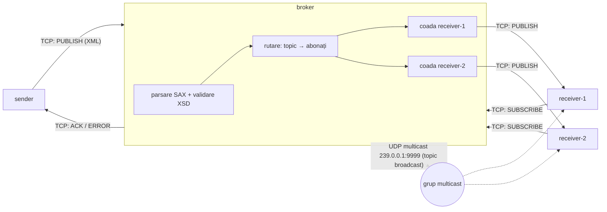

# Arhitectura Lab 1



Aceeași diagramă în ASCII:

```
                    PUBLISH (XML/TCP)
   ┌────────┐  ─────────────────────────►  ┌──────────────────────────────┐
   │ sender │                              │            broker            │
   └────────┘  ◄─────────────────────────  │  parse SAX → validare XSD    │
                    ACK / ERROR            │  map[topic] → {receiverId}   │
                                           │  coadă în memorie / receiver │
                                           └──┬────────────┬───────────┬──┘
                         PUBLISH (TCP)        │            │           │ UDP multicast
                      ┌───────────────────────┘            │           │ (topic "broadcast")
                      ▼                                    ▼           ▼
               ┌────────────┐                      ┌────────────┐  (( 239.0.0.1:9999 ))
               │ receiver-1 │ ◄───── SUBSCRIBE ──► │ receiver-2 │◄────┘  └──► receiver-1
               └────────────┘                      └────────────┘
```

## Componente

| Componentă | Fișier | Rol |
|---|---|---|
| contract | `contracts/message.xsd` | structura mesajului, v1.0 |
| mesaj | `common/message.go` | struct, XML (SAX), JSON, validare |
| transport | `common/transport.go` | interfața `Transport` (Send/Receive/Close), implementată pentru TCP și UDP |
| broker | `broker/broker.go` | rutare pe topic, cozi per receiver, multicast, health |
| sender | `sender/main.go` | publică mesaje și așteaptă ACK/ERROR (deadline 3s) |
| receiver | `receiver/main.go` | se abonează, primește mesajele, se reconectează limitat |

## Fluxul unui mesaj

1. Receiverul trimite `SUBSCRIBE` (sender = receiverId, topic). Brokerul răspunde `ACK`,
   îl adaugă în `subs[topic]` și îi trimite ce era în coadă.
2. Senderul trimite `PUBLISH` cu un `correlationId` nou.
3. Brokerul parsează și validează mesajul. Dacă e invalid, răspunde `ERROR` cu motivul.
4. Dacă e valid, mesajul intră în coada fiecărui abonat la topic, iar abonații online îl primesc imediat.
5. Brokerul răspunde `ACK` cu același `correlationId`. În payload pune `messageId`-ul confirmat.
6. Pe topicul `broadcast`, mesajul nu intră în cozi, ci este trimis o singură dată pe grupul UDP multicast.

Framing TCP: un mesaj XML pe o linie, delimitat de `\n`. Newline-urile din payload sunt escapate ca `&#xA;`.
