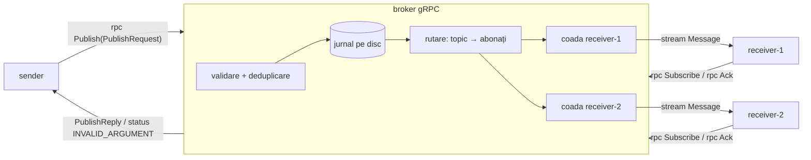

# Arhitectura Lab 2 (gRPC)

Arhitectura e aceeași ca în Lab 1. Se schimbă doar modul în care comunică componentele:
socket-urile TCP și XML-ul sunt înlocuite cu RPC-uri gRPC și mesaje Protocol Buffers.



```
                 rpc Publish(PublishRequest)
   ┌────────┐  ─────────────────────────────►  ┌──────────────────────────────────┐
   │ sender │                                  │           broker (gRPC)          │
   └────────┘  ◄─────────────────────────────  │  validare → INVALID_ARGUMENT     │
                 PublishReply / eroare gRPC    │  deduplicare după message_id     │
                                               │  jurnal (fsync) → data/          │
                                               │  map[topic] → {receiverId}       │
                                               │  coadă neconfirmată / receiver   │
                                               └───────┬──────────────────┬───────┘
                 rpc Subscribe ──► / ◄── stream Message │                  │
                 rpc Ack ──►                            ▼                  ▼
                                               ┌────────────┐      ┌────────────┐
                                               │ receiver-1 │      │ receiver-2 │
                                               └────────────┘      └────────────┘
```

## Lab 1 față de Lab 2

| | Lab 1 (socket-uri) | Lab 2 (RPC) |
|---|---|---|
| comunicare | `net.Listen` / `net.Dial`, framing manual cu `\n` | gRPC peste HTTP/2, framing făcut de bibliotecă |
| reprezentarea datelor | XML + XSD, parsare SAX scrisă manual | Protocol Buffers (`contracts/broker.proto`), cod generat; opțional JSON pe fir (`-codec json`) |
| tipuri de mesaj | `SUBSCRIBE`, `PUBLISH`, `ACK`, `ERROR` | metodele `Subscribe`, `Publish`, `Ack`, `Unsubscribe`. ERROR = cod de status gRPC |
| livrare către receiver | brokerul scrie în socket-ul receiverului | server streaming: `Subscribe` rămâne deschis, iar brokerul face `stream.Send` |
| confirmarea livrării | nu există | `Ack` de la receiver; până atunci mesajul rămâne în coadă (at-least-once) |
| confirmarea abonării | mesaj `ACK` | header-ul stream-ului (`stream.Header()`) |
| persistență | nu | jurnal append-only cu fsync, refăcut la pornire |
| concurență | o goroutine per conexiune, creată manual | gRPC rulează fiecare apel în propria goroutine |
| deadline | `SetReadDeadline` pe socket | `context.WithTimeout`, propagat automat la server (brokerul îl verifică) |
| health check | endpoint HTTP | serviciul standard `grpc.health.v1.Health` (+ reflection pentru grpcurl) |
| securitate | nu | TLS opțional și token Bearer |
| multicast UDP | da | nu: e un mecanism de socket, iar fan-out-ul pe topic îl înlocuiește |

## Componente

| Componentă | Fișier | Rol |
|---|---|---|
| contract | `contracts/broker.proto` | mesajele, serviciul `Broker` și semantica erorilor |
| cod generat | `gen/brokerpb/` (nu e în git) | creat de `./scripts/gen.sh` |
| comun | `common/` | validare, `.env`, logger, codec JSON, conectarea clienților (TLS, token, `WaitReady`) |
| broker (logică) | `internal/broker/broker.go` | `Publish`, `Subscribe`, `Ack`, `Unsubscribe`, cozi, deduplicare, TTL |
| jurnal | `internal/broker/journal.go` | scriere cu fsync, refacere, tăierea liniei incomplete, compactare |
| server | `internal/broker/server.go` | gRPC + health + reflection, autentificare, TLS, oprire ordonată |
| broker (proces) | `broker/main.go` | citește configurarea și pornește `internal/broker.Server` |
| sender | `sender/main.go` | apelează `Publish` cu deadline; reîncearcă cu același `message_id` |
| receiver | `receiver/main.go` | `Subscribe`, procesare, `Ack`; ignoră retrimiterile; se reconectează limitat |

## Starea unui receiver în broker

```
queue:  [ m1 | m2 | m3 | m4 ]      mesaje neconfirmate, în ordinea publicării
          ^^^^^^^^^   ^
          trimise     sent = 2: următorul trimis e m3
```

- `Publish` adaugă la final; `Ack(m1)` scoate m1 și mută cursorul înapoi cu o poziție.
- Un `Subscribe` nou (reconectare sau preluare) pune `sent = 0`, deci m1 și m2 se retrimit.
- Doar sesiunea curentă (ultimul `Subscribe`) poate avansa cursorul.
- Un `Subscribe` cu alte topicuri le înlocuiește pe cele vechi și șterge din coadă mesajele lor.

## Oprirea brokerului (SIGTERM)

1. health devine `NOT_SERVING` (watcherii îl văd pe durata `SHUTDOWN_DRAIN_MS`);
2. apelurile noi primesc `UNAVAILABLE`, cele unary în curs se termină normal;
3. stream-urile `Subscribe` se închid cu `UNAVAILABLE`, deci receiverele se reconectează după repornire;
4. se închid conexiunile și jurnalul; procesul iese cu codul 0.
