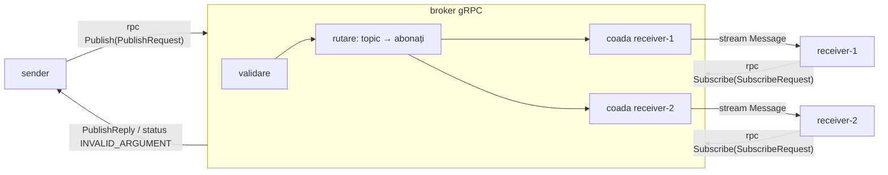

# Arhitectura Lab 2 (gRPC)

Arhitectura e aceeași ca în Lab 1. Se schimbă doar modul în care comunică componentele:
socket-urile TCP și XML-ul sunt înlocuite cu RPC-uri gRPC și mesaje Protocol Buffers.



```
                 rpc Publish(PublishRequest)
   ┌────────┐  ─────────────────────────────►  ┌──────────────────────────────┐
   │ sender │                                  │         broker (gRPC)        │
   └────────┘  ◄─────────────────────────────  │  validare → INVALID_ARGUMENT │
                 PublishReply / eroare gRPC    │  map[topic] → {receiverId}   │
                                               │  coadă în memorie / receiver │
                                               └───────┬──────────────┬───────┘
                       rpc Subscribe ──► / ◄── stream Message         │
                                    ┌──────────────┘                  └──────────────┐
                                    ▼                                                ▼
                             ┌────────────┐                                  ┌────────────┐
                             │ receiver-1 │                                  │ receiver-2 │
                             └────────────┘                                  └────────────┘
```

## Lab 1 față de Lab 2

| | Lab 1 (socket-uri) | Lab 2 (RPC) |
|---|---|---|
| comunicare | `net.Listen` / `net.Dial`, framing manual cu `\n` | gRPC peste HTTP/2, framing făcut de bibliotecă |
| reprezentarea datelor | XML + XSD, parsare SAX scrisă manual | Protocol Buffers (`contracts/broker.proto`), cod generat |
| tipuri de mesaj | `SUBSCRIBE`, `PUBLISH`, `ACK`, `ERROR` | metodele `Subscribe` și `Publish`. ACK = `PublishReply`, ERROR = cod de status gRPC |
| livrare către receiver | brokerul scrie în socket-ul receiverului | server streaming: `Subscribe` rămâne deschis, iar brokerul face `stream.Send` |
| confirmarea abonării | mesaj `ACK` | header-ul stream-ului (`stream.Header()`) |
| concurență | o goroutine per conexiune, creată manual | gRPC rulează fiecare apel în propria goroutine |
| deadline | `SetReadDeadline` pe socket | `context.WithTimeout`, propagat automat la server |
| health check | endpoint HTTP | serviciul standard `grpc.health.v1.Health` (+ reflection pentru grpcurl) |
| multicast UDP | da | nu: e un mecanism de socket, iar fan-out-ul pe topic îl înlocuiește |

## Componente

| Componentă | Fișier | Rol |
|---|---|---|
| contract | `contracts/broker.proto` | mesajele, serviciul `Broker` și semantica erorilor |
| cod generat | `gen/brokerpb/` (nu e în git) | creat de `./scripts/gen.sh` |
| validare | `common/message.go` | regulile pe valori (aceleași ca XSD-ul din Lab 1) |
| broker | `broker/broker.go` | `Publish`, `Subscribe`, cozi per receiver |
| sender | `sender/main.go` | apelează `Publish` cu deadline de 3s |
| receiver | `receiver/main.go` | apelează `Subscribe`, citește stream-ul, se reconectează limitat |
